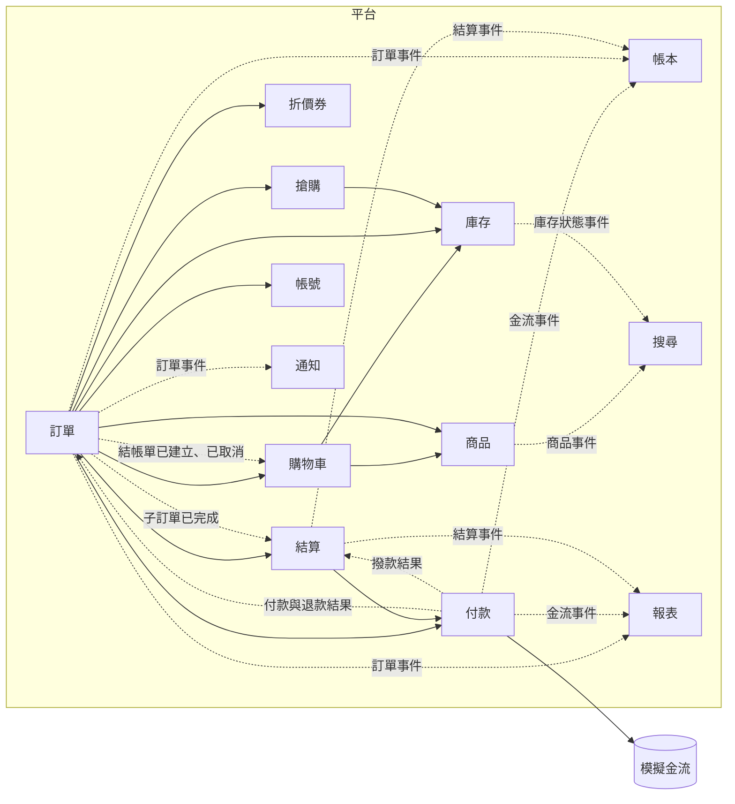

# 多賣家電商平台 領域模型

> 狀態：定版
> 版本：1.2
> 最後更新：2026-10-14
> 依據：《需求_001_需求規格》1.6、《需求_002_使用者故事》1.5

## 1. 目的

定義平台的核心概念、模組邊界與模組之間的關係，作為後續架構、資料庫與 API 設計的共同基礎。

本文件只描述「系統裡有什麼、誰負責什麼」，不涉及具體技術。技術選擇記錄在 ADR 中。

## 2. 通用語言

團隊在需求、程式、資料庫與文件中一律使用相同的名稱。程式與資料庫使用英文名稱。

| 中文 | 英文名稱 | 所屬模組 | 說明 |
|---|---|---|---|
| 會員 | Member | 帳號 | 已註冊的買家 |
| 收件資訊 | ShippingAddress | 帳號 | 會員維護的收件人、電話、地址 |
| 賣家 | Seller | 帳號 | 賣家組織，以「賣家類型」欄位區分平台自營與外部賣家 |
| 賣家類型 | SellerType | 帳號 | 平台自營（FIRST_PARTY）或外部賣家（THIRD_PARTY），決定抽成、撥款與帳本記法 |
| 賣家帳號 | SellerUser | 帳號 | 隸屬於某個賣家的登入帳號；平台自營部門的員工也使用此類帳號，結構與外部賣家的帳號完全相同 |
| 營運帳號 | OperatorUser | 帳號 | 平台營運人員的登入帳號，不能執行任何賣家功能 |
| 賣家角色 | SellerRole | 帳號 | 管理者（ADMIN）或一般成員（MEMBER） |
| 營運角色 | OperatorRole | 帳號 | 營運管理者、活動營運、客服營運、財務營運；一個帳號可有多個角色 |
| 更新權杖 | RefreshToken | 帳號 | 用來換發存取權杖的長效權杖，可撤銷 |
| 條款文件 | TermsDocument | 帳號 | 服務條款、隱私權政策、賣家條款，具有版本 |
| 條款同意 | TermsConsent | 帳號 | 誰在何時同意了哪份文件的哪個版本 |
| 商品 | Product | 商品 | 賣家上架的商品 |
| 分類 | Category | 商品 | 商品的分類 |
| 一般庫存 | Stock | 庫存 | 商品的可賣數量與預扣數量 |
| 搶購庫存 | FlashSaleStock | 庫存 | 搶購劃撥出來的可賣數量與預扣數量 |
| 庫存異動 | StockMovement | 庫存 | 每次庫存變動的紀錄 |
| 購物車 | Cart | 購物車 | 會員的購物車 |
| 結帳單 | Checkout | 訂單 | 一次結帳產生的單據，對應付款 |
| 子訂單 | SellerOrder | 訂單 | 結帳單依賣家拆出的訂單 |
| 退款申請 | RefundRequest | 訂單 | 會員對子訂單提出的退款申請，含核准與申訴 |
| 付款 | Payment | 付款 | 一次付款嘗試 |
| 退款交易 | Refund | 付款 | 向金流執行的一筆退款 |
| 撥款交易 | Payout | 付款 | 向金流執行的一筆撥款 |
| 對帳差異 | ReconciliationDiscrepancy | 付款 | 對帳時發現的差異 |
| 帳本科目 | LedgerAccount | 帳本 | 金流存款、代管款項等科目 |
| 分錄 | JournalEntry | 帳本 | 一筆借貸平衡的記帳交易 |
| 抽成設定 | CommissionRate | 結算 | 外部賣家的抽成比例 |
| 撥款單 | Statement | 結算 | 一次結算中某個賣家的彙總，也是賣家看到的結算對帳單 |
| 搶購檔期 | FlashSaleCampaign | 搶購 | 平台開設的搶購檔期 |
| 搶購報名 | FlashSaleEnrollment | 搶購 | 賣家以某商品報名某檔期 |
| 限購額度 | PurchaseQuota | 搶購 | 某會員在某報名項目已使用的數量 |
| 折價券 | Coupon | 折價券 | 發放給某會員的一張券 |
| 折扣分攤 | DiscountAllocation | 訂單 | 折價券折抵金額分到各子訂單的結果 |
| 批次執行紀錄 | JobExecution | 共用 | 每次批次任務的執行紀錄 |
| 稽核紀錄 | AuditLog | 共用 | 第二級稽核的通用紀錄 |
| 待發送事件 | OutboxEvent | 共用 | 與業務資料在同一交易內寫入、等待發送給訂閱者的事件 |

## 3. 子領域分類

依對專案目標的重要程度分類，決定投入的深度。

| 類型 | 子領域 | 說明 |
|---|---|---|
| 核心 | 訂單、庫存、付款、帳本、搶購 | 專案要練習的高併發、一致性與分散式問題集中在這裡，投入最多 |
| 支撐 | 結算、折價券、購物車、商品、報表、搜尋 | 業務需要且有一定複雜度，但不是練習重點 |
| 通用 | 帳號、通知、稽核、批次執行紀錄 | 每個系統都需要，用最簡單可靠的做法 |

## 4. 模組（限界上下文）

每個模組擁有自己的資料，其他模組不能直接讀寫，只能透過該模組公開的介面或它發布的事件。

| 模組 | 英文名稱 | 負責 | 擁有的資料 | 負責的批次任務 |
|---|---|---|---|---|
| 帳號 | account | 會員、賣家、營運帳號、收件資訊、條款與同意紀錄、認證授權 | Member、ShippingAddress、Seller、SellerUser、OperatorUser、TermsDocument、TermsConsent、RefreshToken | 無 |
| 商品 | catalog | 商品與分類、上下架、價格 | Product、Category | 無 |
| 庫存 | inventory | 一般庫存與搶購庫存的數字與異動 | Stock、FlashSaleStock、StockMovement | 庫存核對 |
| 購物車 | cart | 會員的購物車 | Cart | 無 |
| 訂單 | ordering | 結帳、拆單、訂單狀態、出貨與簽收、退款申請與申訴、折扣分攤 | Checkout、SellerOrder、RefundRequest、DiscountAllocation | 逾時取消、子訂單狀態推進 |
| 付款 | payment | 與金流的所有互動：付款、退款、撥款的執行與結果確認，以及對帳 | Payment、Refund、Payout、ReconciliationDiscrepancy | 付款結果查詢、金流對帳 |
| 帳本 | ledger | 複式記帳與科目餘額 | LedgerAccount、JournalEntry | 無 |
| 結算 | settlement | 抽成設定、結算計算、撥款單與撥款進度 | CommissionRate、Statement | 賣家結算、撥款執行（逐張撥款單請付款模組撥款） |
| 搶購 | flashsale | 檔期、報名與審核、限購額度 | FlashSaleCampaign、FlashSaleEnrollment、PurchaseQuota | 搶購檔期切換 |
| 折價券 | coupon | 發券、鎖定、核銷、歸還、到期 | Coupon | 折價券到期 |
| 報表 | reporting | 賣家報表與平台報表 | 報表資料（由事件與每日任務產生） | 賣家報表、平台報表 |
| 搜尋 | search | 分類瀏覽與關鍵字搜尋 | 搜尋用的商品資料（由商品與庫存的事件產生） | 無 |
| 通知 | notification | 記錄要發送的通知 | 通知紀錄 | 無 |

另有兩項不屬於任何業務模組的共用機制：

- **稽核**：第三級的基本欄位由各模組自行維護；第二級的通用稽核紀錄由共用機制提供；第一級的專屬異動紀錄屬於各自的模組（例如庫存異動屬於庫存模組）
- **批次執行紀錄**：所有批次任務共用同一套執行紀錄與防重複執行的機制

模擬金流是平台之外的獨立服務，只有付款模組會和它互動。

## 5. 模組關係圖

箭頭表示「呼叫或依賴」的方向，實線為同步呼叫，虛線為訂閱事件。

幾個重點：

- **付款模組是金流的唯一出入口**，並負責把金流的格式轉成平台內部的概念，其他模組不知道金流的存在。日後換成真實金流時只需要改付款模組
- **帳本只訂閱事件，不被任何模組直接呼叫**。帳本是記錄者，不參與業務決策
- **搜尋與報表只讀不寫**，資料由其他模組的事件產生，允許最終一致
- **訂單是協調者**，結帳時需要呼叫最多模組，是第一個要仔細設計交易邊界的地方

## 6. 主要聚合

聚合是一組必須一起保持一致的資料。原則上一次交易只修改一個聚合，聚合之間用編號互相參照，不直接持有對方。

| 聚合 | 模組 | 包含 | 必須成立的規則 |
|---|---|---|---|
| Checkout | 訂單 | 付款期限、收件資訊快照、使用的折價券編號、總金額 | 最多一筆成功付款；超過期限不可付款 |
| SellerOrder | 訂單 | 商品快照、金額、賣家類型快照、抽成比例快照、折扣分攤金額、狀態歷程 | 狀態只能依規定的路徑轉換；完成後不可退款 |
| RefundRequest | 訂單 | 申請、核准或拒絕、申訴與裁決 | 拒絕後只能申訴一次；累計退款不超過付款金額 |
| Stock | 庫存 | 可賣數量、預扣數量 | 兩個數字都不得小於零；每次變動都有對應的異動紀錄 |
| FlashSaleStock | 庫存 | 某報名項目的可賣數量、預扣數量 | 同上 |
| PurchaseQuota | 搶購 | 某會員在某報名項目已使用的數量 | 不得超過每人限購數量 |
| Coupon | 折價券 | 狀態、所屬會員、使用的結帳單編號 | 同一時間只能被一張結帳單鎖定 |
| Payment | 付款 | 金額、狀態、金流交易編號 | 狀態確定後只能由金流對帳更正，並留下稽核紀錄 |
| JournalEntry | 帳本 | 多筆借貸明細 | 借貸金額相等；只能新增 |
| Statement | 結算 | 包含的子訂單、抽成、撥款金額、狀態 | 一張子訂單只能被結算一次 |

跨越多個聚合的規則：

- **每位會員的一般結帳與搶購結帳各最多一張待付款**：這條規則涉及同一會員的多個結帳單聚合。同一會員同時送出兩筆結帳時，兩筆可能都看到「目前沒有待付款」而同時通過。以資料庫的唯一性約束保證：同一會員、同一結帳類型，只能有一筆狀態為待付款的結帳單，第二筆寫入由資料庫拒絕，不需要另外的計數器或鎖

## 7. 領域事件

模組完成一件事之後發布事件，讓其他模組各自反應，彼此不需要知道對方的存在。

| 事件 | 發布者 | 訂閱者與反應 |
|---|---|---|
| 結帳單已建立 | 訂單 | 通知：記錄通知 |
| 結帳單已取消 | 訂單 | 通知：記錄通知；購物車：若為會員主動取消的一般結帳單，將商品放回購物車 |
| 結帳單已建立 | 訂單 | 購物車：移除已結帳的商品 |
| 付款已成功 | 付款 | 訂單：結帳單與子訂單變為已付款，確認庫存、核銷折價券；帳本：記錄收款；報表：計入付款當日的銷售 |
| 付款已失敗 | 付款 | 訂單：結帳單維持待付款 |
| 子訂單已出貨 | 訂單 | 通知 |
| 子訂單已完成 | 訂單 | 帳本：代管款項轉為營收或應付賣家款項；結算：外部賣家的子訂單記為待結算；報表：計入折價券費用 |
| 退款已核准 | 訂單 | 付款：向金流發起退款 |
| 退款已成功 | 付款 | 訂單：子訂單變為已退款，必要時回補庫存；帳本：記錄退款；報表：計入退款當日的退款金額 |
| 結算已完成 | 結算 | 帳本：認列抽成；報表：計入抽成收入 |
| 撥款已成功、撥款已失敗 | 付款 | 結算：更新撥款單狀態；帳本：撥款成功時記錄撥款 |
| 商品已上架、已下架、已改價 | 商品 | 搜尋：更新搜尋資料 |
| 庫存狀態已改變 | 庫存 | 搜尋：更新有貨、即將售完、已售完 |

補充說明：

- 「付款已成功」之後的確認庫存與核銷折價券，由訂單模組收到事件後依序呼叫庫存與折價券模組完成
- 「庫存狀態已改變」只在跨越門檻時發布（有貨、即將售完、已售完之間切換），不是每次庫存變動都發布。搶購時每一次預扣都發事件，會在最繁忙的時候多出大量寫入
- 「結帳單已建立」到購物車移除商品之間有數秒延遲，結帳後立刻回到購物車，可能短暫看到已結帳的商品

## 8. 關鍵流程的模組互動

### 8.1 結帳

1. 訂單以冪等鍵檢查是否為重複送出，是則直接回傳既有的結帳單
2. 訂單檢查會員是否已有同類型的待付款結帳單，以及各商品的購買數量上限（前者最終由唯一性約束保證，這裡的檢查是為了提早回應清楚的錯誤訊息）
3. 訂單向購物車取得要結帳的商品
4. 訂單向商品取得各商品目前的價格與上下架狀態
5. 訂單向帳號取得收件資訊，向帳號取得各賣家的類型，向結算取得各外部賣家目前的抽成比例
6. 訂單向折價券鎖定所選的券（若有使用）
7. 訂單建立結帳單與子訂單，計算折扣分攤
8. 訂單向庫存預扣各商品的數量
9. 提交

預扣庫存刻意放在最後，因為它鎖住的是最多人搶的資料，越晚鎖、越早提交，鎖持有的時間越短（見第 10 節第 4 點）。

任何一步失敗時，第一版由資料庫交易自動撤銷所有步驟；日後改為補償方式時，依序執行已完成步驟的反向操作（釋放庫存、解除券的鎖定）。

搶購的立即購買不經過購物車，改為向搶購模組檢查並佔用限購額度，並向庫存預扣搶購庫存，其餘步驟相同。

### 8.2 付款成功

1. 付款模組收到金流的成功結果，將付款標記為成功，發布「付款已成功」
2. 訂單模組將結帳單與子訂單標記為已付款
3. 訂單模組請庫存確認扣除、請折價券核銷
4. 帳本模組記錄收款分錄
5. 若結帳單已取消，或已經有另一筆成功的付款，訂單模組不更新狀態，改為要求付款模組將這筆付款自動全額退款

步驟 2 與 3 在訂單模組處理事件的同一個交易內完成；步驟 4 由帳本模組各自處理。訂單模組的處理失敗會重試，帳本的處理失敗也會重試，兩者互不影響。

## 9. 模組化單體的規則

第一版是單一應用程式，但模組之間的界線要像日後會拆成獨立服務一樣清楚。

- 每個模組有自己的程式套件，只公開介面與事件，內部類別不對外
- 每個模組擁有自己的資料表，其他模組不能直接查詢或寫入，也不能跨模組 JOIN
- 模組之間透過公開介面呼叫，或訂閱事件
- 資料表之間不建立跨模組的外鍵，只保存對方的編號
- 以自動化測試檢查上述規則，違反時建置失敗

## 10. 設計決議

以下四個問題已討論並決議，會在架構設計時以 ADR 正式記錄：

1. **結帳跨模組的一致性如何保證**（已決議，2026-10-14）
   - 第一版以單一資料庫交易包住結帳的所有步驟，作為正確性與效能的比較基準
   - 各模組的介面依補償的需求設計：預扣與釋放、鎖定與解除鎖定為成對操作，且皆可安全重試
   - 當壓測發現結帳的鎖等待成為瓶頸，或庫存預扣移出資料庫（例如改用 Redis）時，改為補償方式，並以壓測數據比較改動前後的差異
2. **結帳單與子訂單是否應為同一個聚合**（已決議，2026-10-14）
   - 分為兩個聚合：結帳單負責付款前的事（付款期限、折價券、收件資訊、付款狀態），子訂單負責付款後的事（出貨、簽收、退款、完成、結算）
   - 付款成功與取消時，在訂單模組內以一個本地交易同時更新結帳單與其所有子訂單。這是刻意的例外，因為這兩個時機都在付款前，賣家尚無法操作子訂單，不會產生競爭
   - 付款後結帳單狀態停在「已付款」，不隨子訂單變化
   - 「累計退款不超過付款金額」由每張子訂單各自守住「退款不超過自己的實付金額」來保證，不需要跨子訂單檢查
3. **事件在單體內如何傳遞**（已決議，2026-10-14）
   - 採用 Outbox：發布事件的模組在同一個資料庫交易內，同時寫入業務資料與待發送事件；由獨立的發送程序讀取並送給訂閱者，處理成功後才標記完成，失敗則重試
   - 事件可能被重複處理，所有訂閱者都必須冪等
   - 事件處理有數秒以內的延遲。因此逾時取消前，除了結帳單狀態，還須向付款模組確認沒有成功或處理中的付款
   - 日後接上訊息佇列時，只需把發送程序的目的地改為佇列
   - 結帳流程中的模組呼叫（見第 1 點）仍為同步呼叫，不經過事件
4. **庫存的熱點問題**（已決議，2026-10-14）
   - 第一版以原子條件更新扣減庫存（可賣數量足夠時才扣減，以影響筆數判斷成敗），並放在結帳交易的最後一步，縮短鎖的持有時間
   - 搶購庫存與一般庫存為不同的資料，搶購的熱點不影響原價購買
   - 搶購階段依序演進，每一步先壓測，達到目標即停止：
     1. 售完快速拒絕、先檢查限購、限流
     2. 改用 Redis 預扣，結帳同時改為補償方式（見第 1 點）
     3. 若尖峰仍壓垮後續流程，加入排隊削峰
   - 另做對照實驗：在同一情境下比較悲觀鎖、樂觀鎖、原子條件更新的吞吐量、回應時間與失敗率，結果記錄為 ADR
   - 不採用庫存分桶

## 11. 版本紀錄

| 版本 | 日期 | 說明 |
|---|---|---|
| 1.0 | 2026-10-14 | 初版定版 |
| 1.1 | 2026-10-14 | 付款狀態確定後可由對帳更正（第 6 節）；結算模組訂閱「子訂單已完成」（第 5、7 節） |
| 1.2 | 2026-10-14 | 通用語言新增賣家角色、營運角色、更新權杖 |
