# 多賣家電商平台 狀態圖與循序圖

> 狀態：定版
> 版本：1.0
> 最後更新：2026-10-14
> 依據：《需求_001_需求規格》1.5、《需求_002_使用者故事》1.4、《設計_001_領域模型》1.1

## 1. 目的

- **狀態圖**：把需求中以表格描述的狀態轉換畫成圖，檢查有沒有漏掉的轉換、走不出去的狀態，以及同一個狀態有沒有兩種解讀
- **循序圖**：畫出關鍵流程中各模組的呼叫順序與交易邊界，作為實作與測試的依據

圖中的模組名稱與《設計_001_領域模型》一致。

圖上的文字只寫簡短的名稱，詳細條件寫在每張圖下方的表格或說明中。

## 2. 狀態圖

圖例：

- **實心圓**是起點，指向物件建立時的第一個狀態
- **圓圈中有一點**是終點。指向終點的狀態是最終狀態，到達後不會再有任何轉換；資料仍會保留，不代表被刪除
- 同一張圖只畫一個終點，多個最終狀態都指向它，不代表它們之間有關係
- **指回自己的箭頭**表示事件發生了，但狀態不變，例如付款失敗後結帳單仍為待付款

### 2.1 結帳單

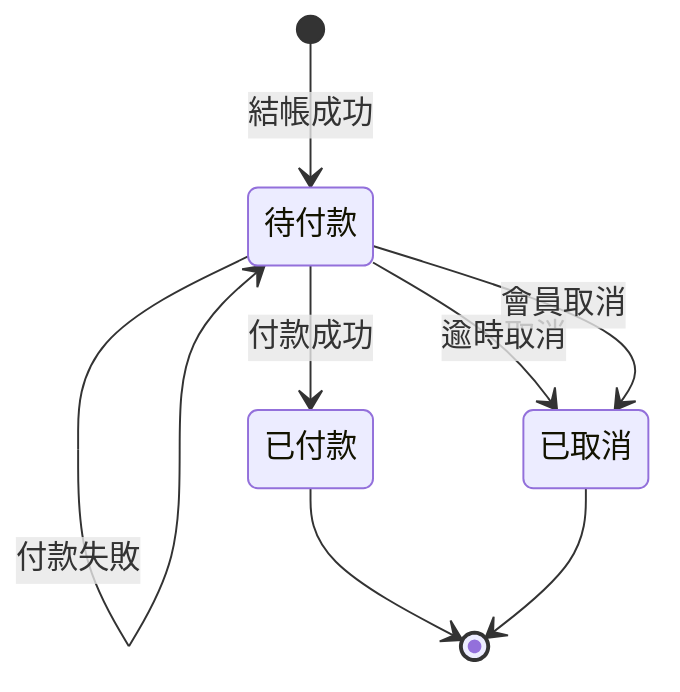

| 轉換 | 條件與說明 |
|---|---|
| 付款成功 | 收到付款成功的結果 |
| 逾時取消 | 超過付款期限，且沒有成功或處理中的付款 |
| 會員取消 | 沒有成功或處理中的付款（付款成功後到結帳單更新之間可能有數秒延遲，見 3.7） |
| 付款失敗 | 維持待付款，會員可在期限內重新付款 |

- 結帳單付款後就不再變動，之後的進度都在子訂單上
- 「已取消」之後才收到付款成功時，結帳單不改變，由付款模組自動退款（見 3.2）

### 2.2 子訂單

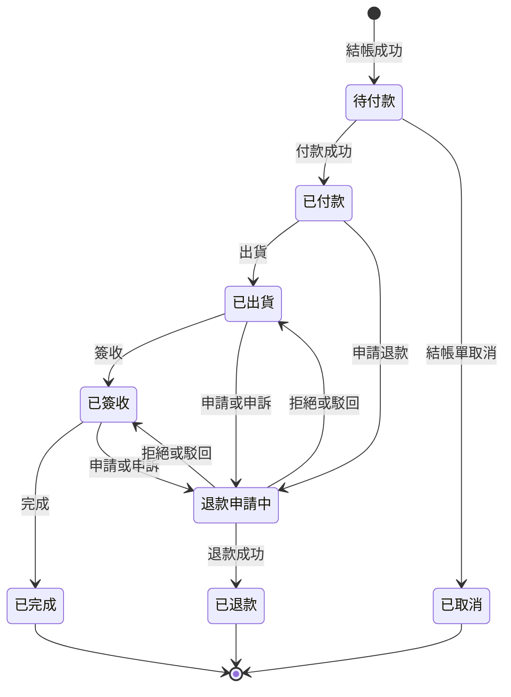

| 轉換 | 條件與說明 |
|---|---|
| 出貨 | 賣家標記出貨 |
| 簽收 | 會員確認收貨，或出貨滿 7 天 |
| 完成 | 簽收滿 7 天，且沒有未結束的退款申請或申訴 |
| 申請退款（從已付款） | 會員申請，系統自動核准 |
| 申請或申訴（從已出貨、已簽收） | 會員申請退款，或對被拒絕的申請在 3 天內提出申訴 |
| 退款成功 | 金流確認退款完成 |
| 拒絕或駁回 | 賣家拒絕申請，或平台營運駁回申訴；回到申請前的狀態，之後依原本的流程繼續：已出貨 → 簽收 → 完成，或已簽收 → 完成 |

- 「退款申請中」代表這張子訂單有尚未結束的退款事項，包含賣家審核中、申訴中、以及核准後等待金流退款完成
- 「退款申請中」有三個出口：退款成功走向「已退款」；被拒絕或駁回時，往回指向「已出貨」或「已簽收」，從那裡沿原本的路線走到「已完成」。圖上往回的箭頭就是流程的延續，不是中斷
- 被拒絕後回到申請前的狀態，但在申訴期限（3 天）內仍不會被自動完成
- 從「已付款」申請的退款會自動核准，不會被拒絕，所以「退款申請中」沒有指回「已付款」的箭頭
- 子訂單同一時間只會有一個操作成功。例如會員申請退款與賣家標記出貨同時發生時，只有先完成的一方成功，另一方會因狀態已改變而失敗

### 2.3 退款申請

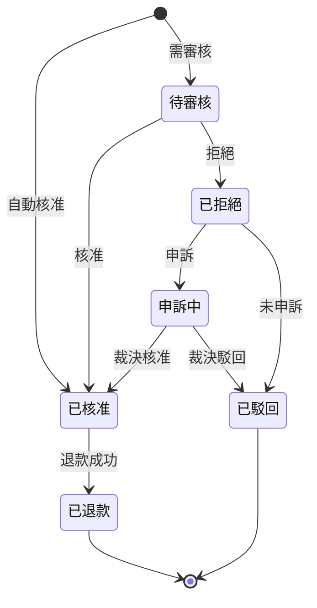

| 轉換 | 條件與說明 |
|---|---|
| 自動核准 | 申請時子訂單尚未出貨 |
| 需審核 | 申請時子訂單已出貨或已簽收 |
| 核准 | 賣家核准，或賣家 3 天未處理 |
| 拒絕 | 賣家拒絕 |
| 申訴 | 會員在被拒絕後 3 天內提出 |
| 未申訴 | 被拒絕後 3 天內沒有提出申訴 |
| 裁決核准、裁決駁回 | 平台營運的裁決 |
| 退款成功 | 金流確認退款完成 |

- 「已核准」之後由付款模組執行退款，失敗會自動重試，退款申請停在「已核准」直到成功
- 「已駁回」與「已退款」是最終狀態，同一張子訂單不能再申請

### 2.4 付款

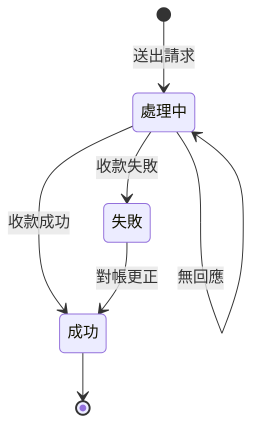

| 轉換 | 條件與說明 |
|---|---|
| 送出請求 | 向金流送出付款請求 |
| 收款成功、收款失敗 | 金流確認的結果 |
| 對帳更正 | 對帳發現金流方實際已收款，並留下稽核紀錄 |
| 無回應 | 連線逾時或金流沒有回應，維持處理中，由付款結果查詢任務追蹤 |

- 「失敗」在絕大多數情況下就是最後的結果，但因為對帳仍可能把它更正為「成功」，所以圖上不畫成最終狀態
- 退款交易與撥款交易的狀態相同，差別是失敗後會自動重試：建立新的嘗試，再次進入「處理中」

### 2.5 折價券

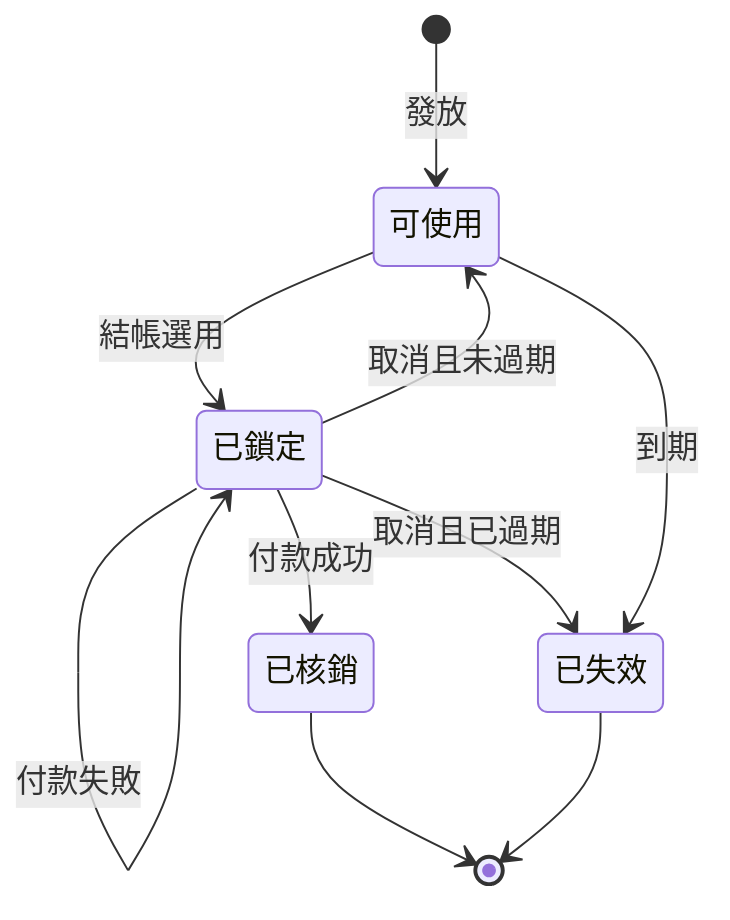

| 轉換 | 條件與說明 |
|---|---|
| 發放 | 平台營運發放給指定會員 |
| 結帳選用 | 會員結帳時選用，且達到門檻、未過期 |
| 付款成功 | 即使券在鎖定後已過期，仍可核銷 |
| 取消且未過期、取消且已過期 | 結帳單被取消時，依當下是否過期決定 |
| 到期 | 折價券到期任務處理 |
| 付款失敗 | 維持已鎖定，因為結帳單仍可重新付款 |

- 「已核銷」不因退款而回到「可使用」

### 2.6 撥款單

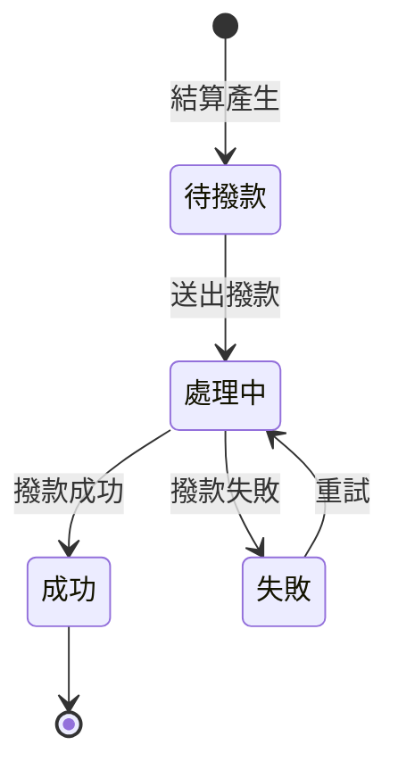

| 轉換 | 條件與說明 |
|---|---|
| 結算產生 | 賣家結算任務產生 |
| 送出撥款 | 撥款執行任務向付款模組要求撥款 |
| 撥款成功、撥款失敗 | 金流確認的結果 |
| 重試 | 下一次撥款執行任務重新送出 |

- 持續失敗時由平台營運介入；撥款單沒有失敗的最終狀態，因為款項終究要撥給賣家

### 2.7 搶購報名

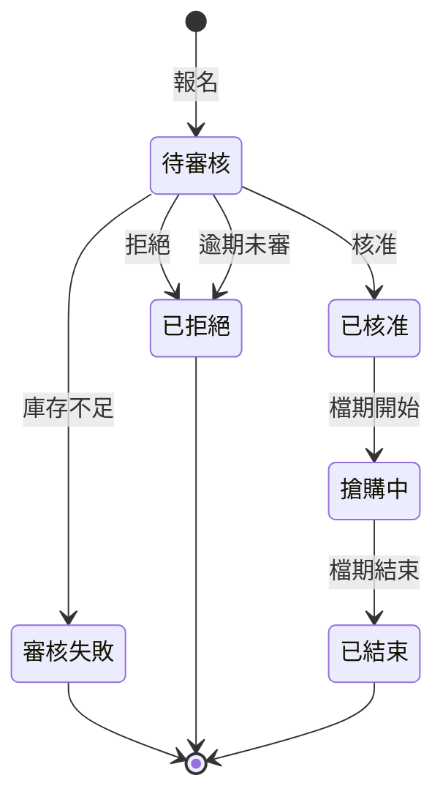

| 轉換 | 條件與說明 |
|---|---|
| 報名 | 賣家在檔期開始前報名 |
| 核准 | 平台營運核准，且庫存劃撥成功 |
| 庫存不足 | 平台營運核准，但一般可賣數量已少於釋出數量 |
| 拒絕 | 平台營運拒絕 |
| 逾期未審 | 檔期開始時仍未審核，由搶購檔期切換任務自動拒絕 |
| 檔期結束 | 剩餘的搶購庫存歸還一般庫存 |

- 「搶購中」售完時仍維持「搶購中」，由搶購庫存的可賣數量判斷是否售完，直到檔期結束

## 3. 循序圖

循序圖中以底色框起來的部分，在同一個資料庫交易內完成。

### 事件的發送方式

模組之間的事件採用 Outbox（見《設計_001_領域模型》第 10 節），運作方式如下：

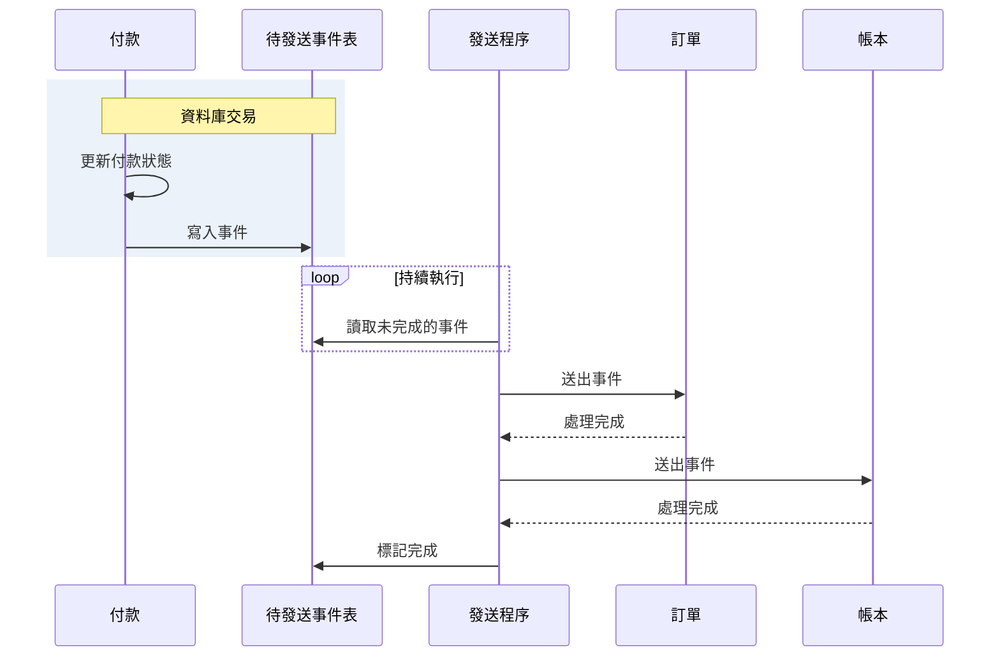

| 步驟 | 說明 |
|---|---|
| 寫入事件 | 和業務資料在同一個交易內寫入，兩者一起成功或一起失敗，事件不會遺失 |
| 讀取未完成的事件 | 發送程序獨立於各模組持續執行，每隔數百毫秒讀取一次 |
| 送出事件 | 依序送給每個訂閱者，每個訂閱者分別記錄是否處理完成 |
| 標記完成 | 所有訂閱者都處理完成才標記；某個訂閱者失敗時，下次只重送給它 |

以下各循序圖為了簡潔，不再畫出待發送事件表，只畫「發送程序 → 訂閱者」這一段。圖上從發送程序出發的箭頭，代表「發送程序從待發送事件表讀到這個事件，送給訂閱者」。

### 3.1 一般結帳

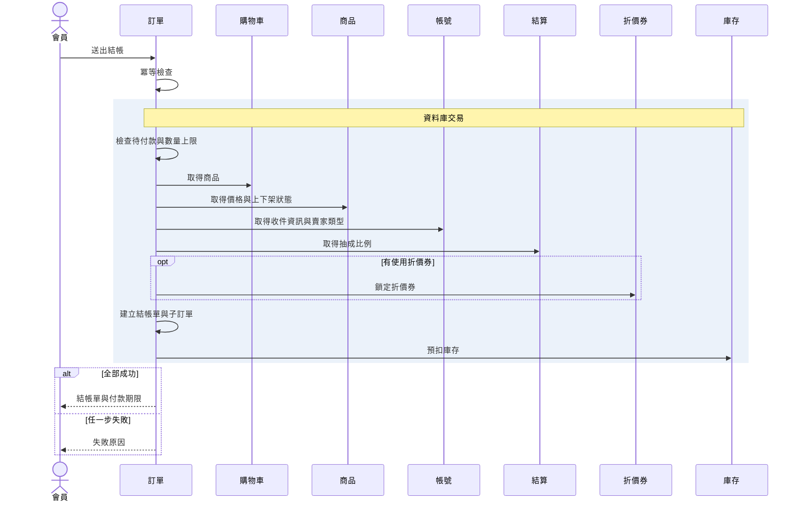

| 步驟 | 說明 |
|---|---|
| 送出結帳 | 帶有冪等鍵、收件資訊、選用的折價券 |
| 冪等檢查 | 冪等鍵已存在時直接回傳既有的結帳單 |
| 檢查待付款與數量上限 | 是否已有一般的待付款結帳單；單一商品是否超過 99 件 |
| 鎖定折價券 | 同時檢查門檻與期限 |
| 建立結帳單與子訂單 | 計算折扣分攤，並寫入「結帳單已建立」事件 |
| 預扣庫存 | 原子條件更新；放在最後，縮短庫存鎖的持有時間 |
| 失敗原因 | 交易自動撤銷所有步驟 |

- 「結帳單已建立」事件由發送程序送給購物車，移除已結帳的商品
- 同一會員同時送出兩筆結帳時，由資料庫的唯一性約束擋下第二筆

### 3.2 付款與付款成功

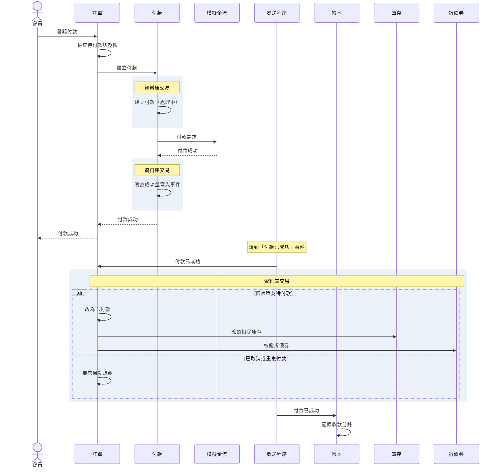

| 步驟 | 說明 |
|---|---|
| 建立付款（處理中） | 先確認這張結帳單沒有處理中的付款，避免重複收款。這筆紀錄必須在呼叫金流之前提交：若先呼叫金流再寫紀錄，中途當機時金流已扣款，平台卻沒有任何紀錄可以追查 |
| 改為成功並寫入事件 | 付款狀態與「付款已成功」事件在同一個交易內寫入 |
| 付款成功（回應會員） | 會員查詢付款結果時立即可見，不必等訂單更新 |
| 改為已付款 | 結帳單與其所有子訂單一起更新 |
| 已取消或重複付款 | 結帳單已取消，或已有另一筆成功付款；不改變狀態，寫入「要求自動退款」事件，由發送程序送給付款模組執行退款 |
| 記錄收款分錄 | 已記錄過同一事件則忽略 |

- 訂單與帳本各自處理事件，任一方失敗只會重試自己，不影響另一方
- 每個訂閱者都必須能辨識重複的事件，重複收到時不重複處理

### 3.3 付款結果不明

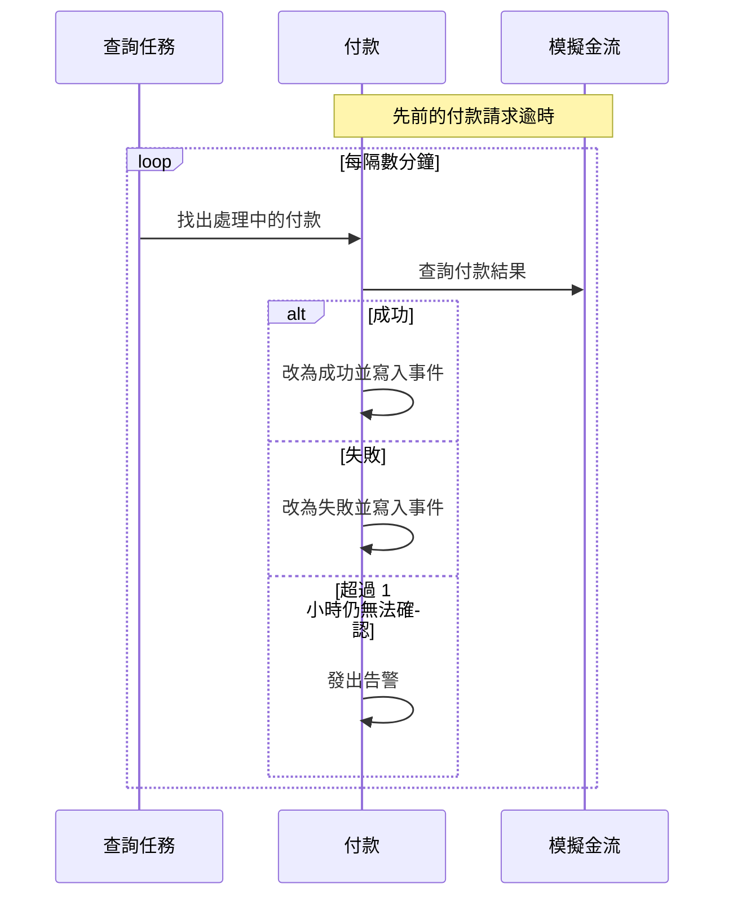

- 「查詢任務」即付款結果查詢任務
- 改為成功後的處理同 3.2；改為失敗時寫入「付款已失敗」事件，結帳單維持待付款
- 告警後由平台營運處理

### 3.4 已出貨子訂單的退款

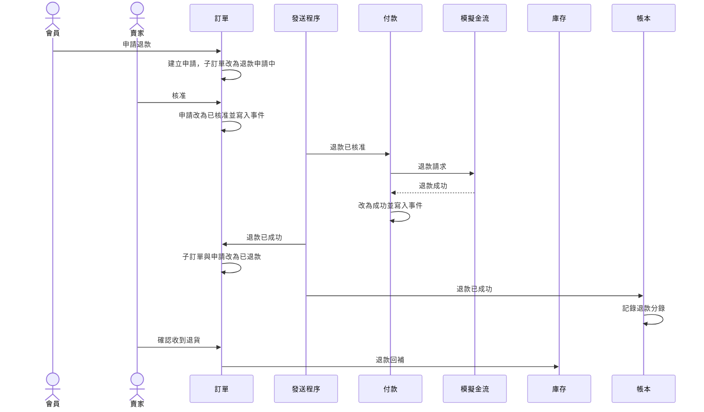

- 退款請求的金額為該子訂單的實付金額（原始金額扣除分攤的折扣）
- 退款回補回到一般庫存；賣家也可以選擇不回補
- 賣家確認收到退貨與退款流程互相獨立，可能發生在退款成功之前或之後
- 金流退款失敗時，付款模組會自動重試，退款申請停在「已核准」，子訂單停在「退款申請中」
- 賣家拒絕時，子訂單回到申請前的狀態，會員可在 3 天內申訴；申訴核准後從「申請改為已核准」接續上圖
- 賣家 3 天未處理時，由子訂單狀態推進任務自動核准，同樣接續上圖

### 3.5 每日結算與撥款

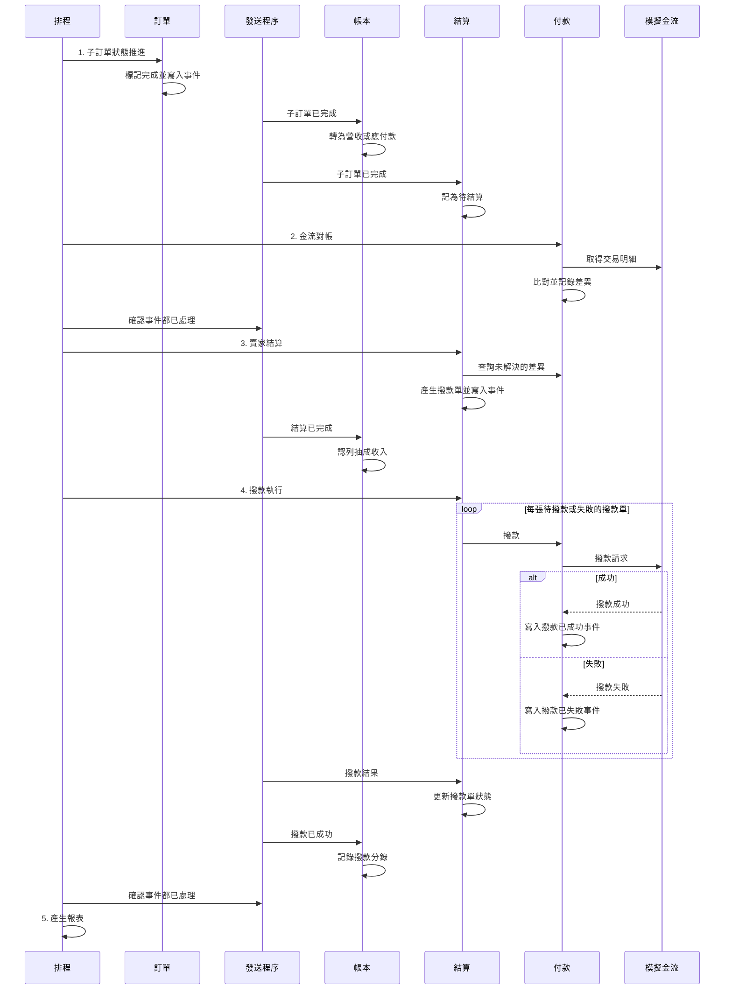

| 步驟 | 說明 |
|---|---|
| 標記完成並寫入事件 | 簽收滿 7 天且沒有未結束退款事項的子訂單改為已完成，寫入「子訂單已完成」事件 |
| 轉為營收或應付款 | 代管款項轉為平台營收（自營）或應付賣家款項（外部賣家） |
| 記為待結算 | 只記錄外部賣家的子訂單 |
| 確認事件都已處理（結算前） | 第 1 步產生的「子訂單已完成」事件是非同步處理的。結算前必須確認這些事件都已被結算與帳本處理完畢，否則當天完成的子訂單會漏掉、延到隔天才結算 |
| 查詢未解決的差異 | 有未解決對帳差異的結帳單，其子訂單本次不結算；因此待結算資料需記錄子訂單所屬的結帳單編號 |
| 產生撥款單並寫入事件 | 依賣家彙總，每個賣家一張，寫入「結算已完成」事件 |
| 更新撥款單狀態 | 成功或失敗；失敗的撥款單在下一次撥款執行時重試 |
| 確認事件都已處理（報表前） | 報表依賴付款、退款、完成、結算等事件累積的資料，產生前同樣要確認這些事件都已處理完畢 |
| 產生報表 | 賣家報表與平台報表 |

- 每一步完成且成功才執行下一步
- 結算模組自己保存待結算的子訂單資料，不查詢訂單模組的資料表

### 3.6 搶購的立即購買

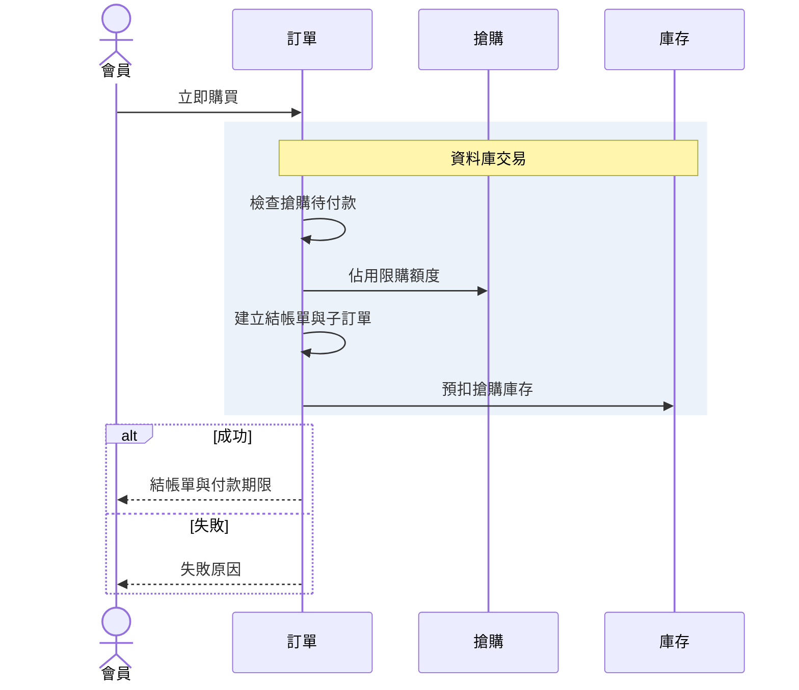

| 步驟 | 說明 |
|---|---|
| 立即購買 | 帶有冪等鍵、報名項目、數量、收件資訊 |
| 檢查搶購待付款 | 是否已有一張搶購的待付款結帳單 |
| 佔用限購額度 | 同時確認檔期進行中；超過每人限購數量則失敗 |
| 建立結帳單與子訂單 | 使用活動價，付款期限 10 分鐘 |
| 預扣搶購庫存 | 原子條件更新，放在最後 |
| 失敗原因 | 已售完、超過限購或其他原因；交易自動撤銷 |

- 取得價格與上下架狀態、收件資訊、賣家類型、抽成比例的步驟與 3.1 相同，圖中省略；價格改用報名的活動價
- 不經過購物車，不能使用折價券
- 這是搶購階段壓測的主要路徑，演進方式見《設計_001_領域模型》第 10 節第 4 點

### 3.7 逾時取消

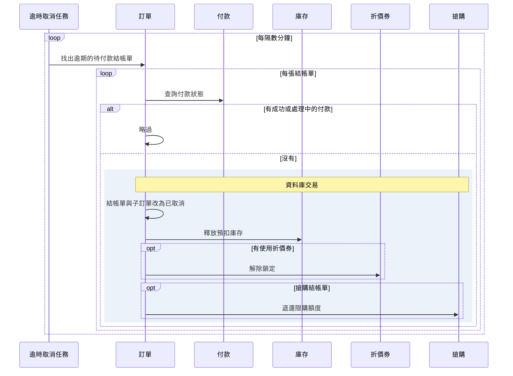

| 步驟 | 說明 |
|---|---|
| 找出逾期的待付款結帳單 | 一般結帳單 30 分鐘、搶購結帳單 10 分鐘 |
| 查詢付款狀態 | 付款成功後，「付款已成功」事件可能還在待發送事件表中，結帳單仍顯示待付款。所以不能只看結帳單狀態，必須向付款模組確認 |
| 略過 | 有成功的付款：結帳單稍後會因事件變為已付款。有處理中的付款：等付款結果確定後，下一輪再判斷 |
| 結帳單與子訂單改為已取消 | 同時寫入「結帳單已取消」事件 |
| 釋放預扣庫存 | 搶購結帳單釋放到搶購庫存；若檔期已結束，則歸還一般庫存 |
| 解除鎖定 | 券回到可使用；若已過期則變為已失效 |

- 會員主動取消的流程相同，同樣要向付款模組確認沒有成功或處理中的付款；差別是由會員觸發，且一般結帳單的商品會透過「結帳單已取消」事件放回購物車
- 每張結帳單各自一個交易，單張失敗不影響其他結帳單

## 4. 版本紀錄

| 版本 | 日期 | 說明 |
|---|---|---|
| 1.0 | 2026-10-14 | 初版定版 |
