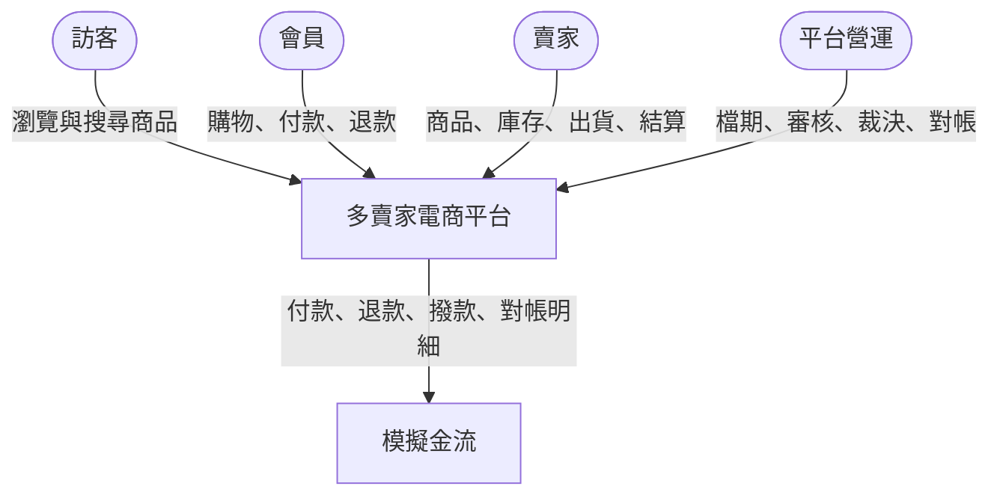
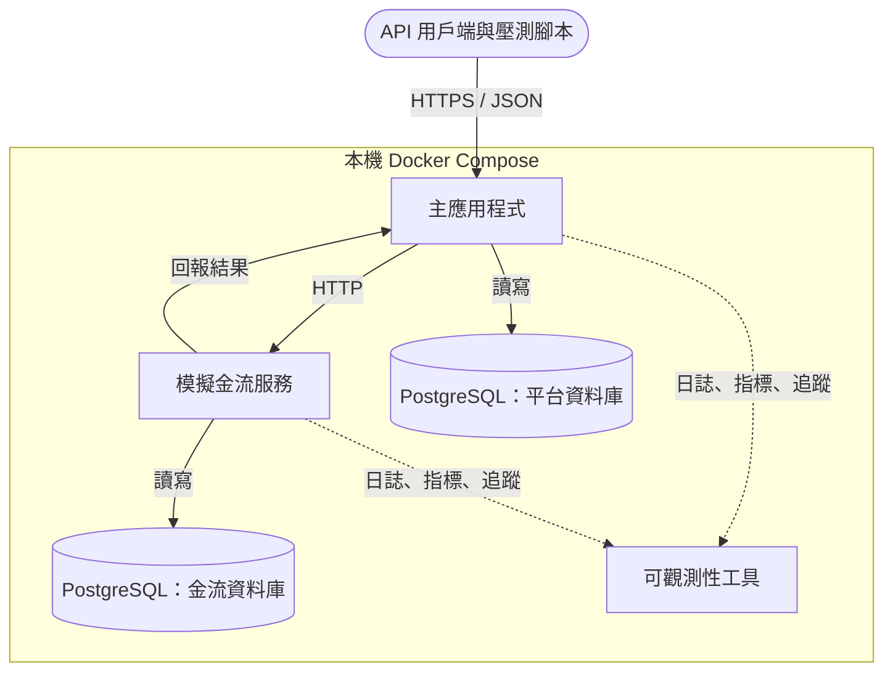

# 多賣家電商平台 系統架構

> 狀態：定版
> 版本：1.3
> 最後更新：2026-10-14
> 依據：《需求_001_需求規格》1.6、《設計_001_領域模型》1.1、《設計_002_狀態圖與循序圖》1.0

## 1. 目的

描述系統由哪些部分組成、彼此如何互動、使用哪些技術，以及架構預計如何演進。採用 C4 模型的前兩層描述系統，第三層（元件）即《設計_001_領域模型》的模組劃分。

個別技術決策的理由記錄在 ADR 中，本文件只列結論並引用對應的 ADR。

## 2. 系統情境



- 前端尚未實作，現階段由 API 測試工具與壓測腳本扮演各角色
- 模擬金流是平台之外的系統，以獨立的服務模擬真實金流的行為，包括延遲、失敗與重複回報

## 3. 容器

### 3.1 第一版



| 容器 | 說明 | 技術 |
|---|---|---|
| 主應用程式 | 所有業務模組，以模組化單體的方式組成 | Java 25、Spring Boot 4、Spring Modulith |
| 模擬金流服務 | 模擬付款、退款、撥款、交易查詢與每日交易明細；可設定延遲、失敗率與重複回報 | Java 25、Spring Boot 4 |
| 平台資料庫 | 主應用程式的所有資料，每個模組擁有自己的資料表 | PostgreSQL |
| 金流資料庫 | 模擬金流服務的交易紀錄 | PostgreSQL，與平台資料庫分開 |
| 可觀測性工具 | 收集日誌、指標與追蹤，提供查詢介面 | Grafana 整合映像檔（含 Loki、Tempo、Prometheus 相容的指標儲存） |

兩個資料庫在本機可以放在同一個 PostgreSQL 容器內的不同資料庫，但程式與設定上視為兩個獨立的資料庫，模擬金流與平台不共用任何資料。

### 3.2 預計的演進

以下容器會在對應的階段，依壓測或需求的需要加入，屆時另寫 ADR：

| 容器 | 預計加入的時機 | 用途 |
|---|---|---|
| Redis | 讀取效能與搶購階段 | 商品頁快取、搶購庫存預扣、售完旗標、限流 |
| 訊息佇列 | 事件與一致性階段 | 承接 Outbox 的事件，讓模組可以拆成獨立服務 |
| 搜尋引擎 | 讀取效能階段 | 關鍵字搜尋與分類瀏覽 |
| 讀取副本 | 讀取效能或報表階段 | 分擔查詢與報表的讀取負載 |

## 4. 技術選型

| 項目 | 選擇 | ADR |
|---|---|---|
| 程式語言 | Java 25 | ADR_002 |
| 框架 | Spring Boot 4（建立專案時採用最新穩定版） | ADR_002 |
| 模組化與事件 | Spring Modulith | ADR_001、ADR_007 |
| 資料庫 | PostgreSQL | ADR_003 |
| 資料存取 | 以 JPA 為主，效能敏感的操作直接寫 SQL | ADR_004 |
| 資料庫遷移 | Flyway | 本文件 |
| 建置工具 | Maven（使用 Maven Wrapper） | 本文件 |
| 測試 | JUnit、AssertJ、Mockito、Testcontainers | 本文件 |
| 程式碼格式 | Spotless 搭配 google-java-format，建置時檢查 | 本文件 |
| 可觀測性 | Micrometer、OpenTelemetry、Spring Boot 結構化日誌 | 本文件 |
| 認證與授權 | Spring Security；帳號密碼登入，以 JWT 維持登入狀態 | ADR_009 |
| 識別碼 | UUIDv7，由應用程式產生 | ADR_010 |
| API 設計 | 依使用對象分路徑前綴、路徑版本、Problem Details、冪等鍵標頭、先寫 OpenAPI 規格再產生介面 | ADR_011 |
| 模擬金流的介面 | 混合模式：同步回應與簽章回呼並存，可主動查詢 | ADR_012 |
| 本機環境 | Docker Compose | 本文件 |

未列入本文件、各有獨立 ADR 的設計決策：

| ADR | 主題 |
|---|---|
| ADR_005 | 結帳跨模組的一致性：單一交易起步 |
| ADR_006 | 結帳單與子訂單分為兩個聚合 |
| ADR_008 | 庫存熱點：原子條件更新與演進路線 |

## 5. 專案結構

依《通用_001_統一注意事項》的資料夾規則：

```text
marketplace-platform/
├── docs/                              文件
├── backend/
│   ├── spring-marketplace-app/        主應用程式
│   └── spring-mock-payment-gateway/   模擬金流服務
├── infra/
│   └── docker-compose.yml             本機環境
└── scripts/                           工具程式（轉檔、壓測腳本等）
```

主應用程式的套件結構，每個模組一個頂層套件：

```text
com.marketplace
├── account
├── catalog
├── inventory
├── cart
├── ordering
├── payment
├── ledger
├── settlement
├── flashsale
├── coupon
├── reporting
├── search
├── notification
└── shared          共用機制：稽核、批次執行紀錄、冪等、時間
```

每個模組內部的慣例：

| 位置 | 內容 | 其他模組能否使用 |
|---|---|---|
| 模組的頂層套件 | 對外公開的介面、事件、資料傳輸物件 | 可以 |
| `internal` 子套件 | 實作、資料存取、聚合 | 不可以，由 Spring Modulith 的驗證測試檢查 |

## 6. 跨模組的共通設計

| 主題 | 做法 |
|---|---|
| 模組間事件 | Outbox，由 Spring Modulith 的事件持久化實現，見 ADR_007 |
| 冪等 | 對外寫入的 API 接受冪等鍵；事件訂閱者以事件編號判斷是否處理過 |
| 時間 | 資料庫一律儲存帶時區的時間戳記（UTC）；日期的判定（每日任務、報表、滿 N 天）以台灣時間換算 |
| 金額 | 新臺幣整數元，程式中以整數型別表示，不使用浮點數 |
| 系統時間 | 程式一律透過可替換的時鐘取得目前時間，測試中可以控制 |
| 可調整的設定 | 逾時時限、天數、上限等數值集中為設定項目，同時供業務邏輯與規則告知使用 |
| 批次任務 | 共用的執行紀錄與防重複執行機制，多台機器時同一任務只會有一個在跑 |
| 稽核 | 第二級稽核由共用機制記錄；第一級的異動紀錄由各模組負責 |
| 追蹤 | 每個請求帶有 trace ID，跨服務呼叫與事件都會傳遞 |

## 7. 演進路線

| 階段 | 內容 | 主要驗證的需求 |
|---|---|---|
| 1 | 第一版：結帳、拆單、付款、逾時取消（需求第 6 節） | 正確性、冪等、稽核基礎 |
| 2 | 可觀測性：日誌、指標、追蹤 | 可觀測性 |
| 3 | 併發正確性：重現超賣，比較三種鎖定方式 | 一致性、ADR_008 的對照實驗 |
| 4 | 出貨、退款、帳本、結算、撥款、對帳與每日任務 | 批次、可稽核性 |
| 5 | 讀取效能：快取、搜尋、讀取副本 | 讀取效能、資料新鮮度 |
| 6 | 限時搶購與尖峰寫入 | 尖峰寫入、過載保護 |
| 7 | 折價券 | 折扣分攤 |
| 8 | 訊息佇列與拆分服務 | 補償方式（ADR_005 的檢討條件） |
| 9 | 上雲：容器化部署、IaC、自動擴縮 | 可用性 |
| 10 | 前端 | 會員網站、賣家後台、營運後台 |

每個階段開始前，先寫該階段需要的設計文件；結束時以壓測或測試結果驗證，並視需要新增 ADR。

## 8. 尚待決定的事項

以下架構層級的問題本文件尚未決定，會在對應的設計文件中以 ADR 決定：

| 事項 | 決定的時機 |
|---|---|
| 壓測工具 | 併發正確性階段開始前 |

## 9. 版本紀錄

| 版本 | 日期 | 說明 |
|---|---|---|
| 1.0 | 2026-10-14 | 初版定版 |
| 1.1 | 2026-10-14 | 認證方式已決定（ADR_009），從待決定事項移到技術選型 |
| 1.2 | 2026-10-14 | 識別碼的產生方式已決定（ADR_010），從待決定事項移到技術選型 |
| 1.3 | 2026-10-14 | API 設計慣例與模擬金流的介面形式已決定（ADR_011、ADR_012） |
