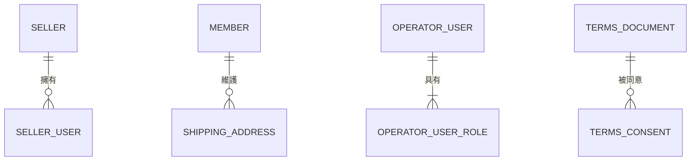
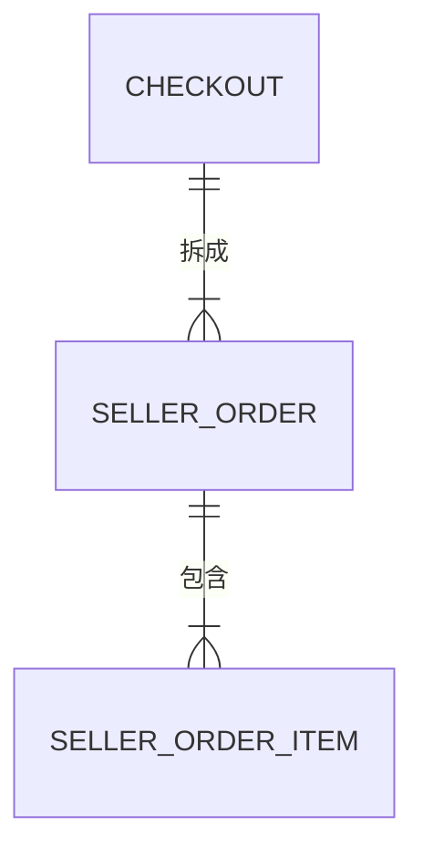

# 多賣家電商平台 資料庫設計

> 狀態：定版
> 版本：1.2
> 最後更新：2026-10-15
> 依據：《需求_001_需求規格》1.8、《設計_001_領域模型》1.2、《設計_002_狀態圖與循序圖》1.0、《設計_003_系統架構》1.2、《設計_005_API規格》、ADR_003、ADR_004、ADR_010

## 1. 範圍

- 第 2 節的設計慣例適用於所有階段
- 第 3 節以後的資料表規格只涵蓋**第一版**（需求第 6 節），以及第一版依賴的資料（例如結帳時需要的抽成比例）
- 出貨、退款、結算、搶購、折價券等資料表，在各自的階段開始前補充到本文件並升版

## 2. 設計慣例

### 2.1 結構

- 平台資料庫中，**每個模組一個 schema**，名稱與模組英文名稱相同，例如 `ordering`、`inventory`。模組只讀寫自己 schema 內的資料表，邊界在資料庫層也清楚可見，日後拆出服務時可以整個 schema 搬走
- 共用機制使用 `shared` schema
- 同一個模組內的資料表可以建立外鍵；**跨模組不建立外鍵**，只保存對方的識別碼
- 資料表與欄位名稱一律使用小寫加底線，資料表名稱用單數

### 2.2 欄位型別

| 用途 | 型別 | 說明 |
|---|---|---|
| 識別碼 | `uuid` | UUIDv7，由應用程式產生（ADR_010） |
| 金額 | `bigint` | 新臺幣整數元；不使用浮點數或小數型別 |
| 數量 | `integer` | |
| 比例 | `integer` | 以萬分之一為單位，例如 10% 存為 1000，避免小數運算的誤差 |
| 時間 | `timestamptz` | 一律以 UTC 儲存；日期的判定在應用程式中換算為台灣時間 |
| 狀態與類型 | `text` 加上 `CHECK` 限制 | 不使用 PostgreSQL 的列舉型別，新增狀態時只需修改限制 |
| 變更前後的內容 | `jsonb` | 只用於稽核紀錄 |

### 2.3 共通欄位（第三級稽核）

除了只能新增的紀錄表之外，每張資料表都有以下欄位：

| 欄位 | 型別 | 說明 |
|---|---|---|
| `created_at` | `timestamptz` | 建立時間 |
| `created_by` | `text` | 建立者 |
| `updated_at` | `timestamptz` | 最後修改時間 |
| `updated_by` | `text` | 最後修改者 |
| `version` | `bigint` | 版本號，用於樂觀鎖；每次修改加一 |

操作者以「類型:識別碼」的文字表示，例如 `MEMBER:0192...`、`SELLER_USER:0192...`、`OPERATOR:0192...`；排程系統為 `JOB:逾時取消`。

只能新增的紀錄表（例如庫存異動、狀態歷程、分錄、稽核紀錄）只有 `created_at` 與 `created_by`，並加上 `trace_id`。

### 2.4 刪除

業務資料不做實體刪除。需要「移除」的情況以狀態表示，例如商品下架、帳號停用。

例外：

| 資料表 | 刪除時的紀錄方式 |
|---|---|
| 購物車項目 | 可以直接刪除（需求 3.6）。新增、修改、刪除都寫一筆結構化日誌，內容包含會員、商品、數量變化、原因（會員操作、結帳後移除、取消後放回）與 trace ID |
| 營運帳號的角色 | 移除角色時刪除該筆資料，並寫入第二級稽核紀錄（帳號權限屬於第二級，需求 3.6） |

## 3. 帳號模組（`account`）



### `member`：會員

| 欄位 | 型別 | 限制 | 說明 |
|---|---|---|---|
| `id` | `uuid` | 主鍵 | |
| `username` | `text` | 唯一，不分大小寫 | 登入帳號 |
| `password_hash` | `text` | 必填 | 密碼雜湊值 |
| `display_name` | `text` | 必填 | |
| `status` | `text` | `ACTIVE`、`DISABLED` | |
| `failed_login_count` | `integer` | 預設 0 | 連續登入失敗次數 |
| `locked_until` | `timestamptz` | 可為空 | 鎖定到何時；為空或已過期表示未鎖定 |
| 共通欄位 | | | |

### `shipping_address`：收件資訊

| 欄位 | 型別 | 限制 | 說明 |
|---|---|---|---|
| `id` | `uuid` | 主鍵 | |
| `member_id` | `uuid` | 外鍵 → `member` | |
| `recipient_name` | `text` | 必填 | |
| `phone` | `text` | 必填 | |
| `address` | `text` | 必填 | |
| `is_default` | `boolean` | | 每位會員最多一筆為預設 |
| `deleted_at` | `timestamptz` | 可為空 | 刪除時間；不為空表示已刪除，查詢時排除 |
| 共通欄位 | | | |

「每位會員最多一筆預設」以 `(member_id)` 唯一、只對 `is_default = true` 且 `deleted_at` 為空的資料生效的索引保證。

刪除以標記方式處理。已建立的結帳單保存的是收件資訊的快照，不受刪除影響。

### `seller`：賣家

| 欄位 | 型別 | 限制 | 說明 |
|---|---|---|---|
| `id` | `uuid` | 主鍵 | |
| `name` | `text` | 必填 | |
| `seller_type` | `text` | `FIRST_PARTY`、`THIRD_PARTY` | |
| `status` | `text` | `ACTIVE`、`DISABLED` | |
| 共通欄位 | | | |

### `seller_user`：賣家帳號

| 欄位 | 型別 | 限制 | 說明 |
|---|---|---|---|
| `id` | `uuid` | 主鍵 | |
| `seller_id` | `uuid` | 外鍵 → `seller` | |
| `username` | `text` | 唯一，不分大小寫 | |
| `password_hash` | `text` | 必填 | |
| `role` | `text` | `ADMIN`、`MEMBER` | 賣家帳號只有一個角色 |
| `status` | `text` | `ACTIVE`、`DISABLED` | |
| `failed_login_count` | `integer` | 預設 0 | |
| `locked_until` | `timestamptz` | 可為空 | |
| `must_change_password` | `boolean` | 預設 false | 以初始密碼建立的帳號為 true，修改密碼後改為 false |
| 共通欄位 | | | |

### `operator_user`：營運帳號

| 欄位 | 型別 | 限制 | 說明 |
|---|---|---|---|
| `id` | `uuid` | 主鍵 | |
| `username` | `text` | 唯一，不分大小寫 | |
| `password_hash` | `text` | 必填 | |
| `status` | `text` | `ACTIVE`、`DISABLED` | |
| `failed_login_count` | `integer` | 預設 0 | |
| `locked_until` | `timestamptz` | 可為空 | |
| `must_change_password` | `boolean` | 預設 false | 同 `seller_user` |
| 共通欄位 | | | |

### `operator_user_role`：營運帳號的角色

一個營運帳號可以有多個角色，所以角色另存一張表。

| 欄位 | 型別 | 限制 | 說明 |
|---|---|---|---|
| `operator_user_id` | `uuid` | 主鍵之一，外鍵 → `operator_user` | |
| `role` | `text` | 主鍵之一；`ADMIN`、`CAMPAIGN`、`CUSTOMER_SERVICE`、`FINANCE` | 營運管理者、活動營運、客服營運、財務營運 |
| `created_at` | `timestamptz` | | |
| `created_by` | `text` | | |

角色的指派只新增或刪除，不修改。

### `refresh_token`：更新權杖

| 欄位 | 型別 | 限制 | 說明 |
|---|---|---|---|
| `id` | `uuid` | 主鍵 | |
| `account_type` | `text` | `MEMBER`、`SELLER_USER`、`OPERATOR` | |
| `account_id` | `uuid` | 必填 | |
| `token_hash` | `text` | 唯一 | 只存雜湊值，不存權杖本身 |
| `expires_at` | `timestamptz` | 必填 | |
| `revoked_at` | `timestamptz` | 可為空 | 撤銷時間 |
| `replaced_by` | `uuid` | 可為空 | 換發後的新權杖 |
| `created_at` | `timestamptz` | | |

索引：`(account_type, account_id)`，只包含 `revoked_at` 為空的資料。撤銷某帳號所有權杖時使用。

已經換發過（`replaced_by` 不為空）的權杖若再次被使用，表示權杖可能已外洩，立即撤銷該帳號所有的更新權杖。

### `terms_document`：條款文件

| 欄位 | 型別 | 限制 | 說明 |
|---|---|---|---|
| `id` | `uuid` | 主鍵 | |
| `document_type` | `text` | `TERMS_OF_SERVICE`、`PRIVACY_POLICY`、`SELLER_TERMS` | 服務條款、隱私權政策、賣家條款 |
| `version` | `integer` | 必填 | 同一類文件從 1 開始遞增 |
| `content` | `text` | 必填 | |
| `published_at` | `timestamptz` | 必填 | |
| `published_by` | `text` | 必填 | |

`(document_type, version)` 唯一。只新增不修改。

### `terms_consent`：條款同意紀錄

| 欄位 | 型別 | 限制 | 說明 |
|---|---|---|---|
| `id` | `uuid` | 主鍵 | |
| `account_type` | `text` | `MEMBER`、`SELLER_USER` | |
| `account_id` | `uuid` | 必填 | 同意的帳號 |
| `seller_id` | `uuid` | 可為空 | 賣家條款由管理者帳號代表賣家同意時，記錄代表的賣家 |
| `terms_document_id` | `uuid` | 外鍵 → `terms_document` | |
| `consented_at` | `timestamptz` | 必填 | |

`(account_type, account_id, terms_document_id)` 唯一。只新增不修改。

## 4. 商品模組（`catalog`）

### `category`：分類

| 欄位 | 型別 | 限制 | 說明 |
|---|---|---|---|
| `id` | `uuid` | 主鍵 | |
| `name` | `text` | 必填 | |
| `parent_id` | `uuid` | 外鍵 → `category`，可為空 | 上層分類；為空表示第一層 |
| `sort_order` | `integer` | 預設 0 | 同層分類的顯示順序 |
| 共通欄位 | | | |

### `product`：商品

| 欄位 | 型別 | 限制 | 說明 |
|---|---|---|---|
| `id` | `uuid` | 主鍵 | |
| `seller_id` | `uuid` | 必填 | 參照帳號模組，不建外鍵 |
| `category_id` | `uuid` | 外鍵 → `category` | |
| `name` | `text` | 必填 | |
| `description` | `text` | | |
| `price` | `bigint` | 大於 0 | |
| `status` | `text` | `LISTED`、`UNLISTED` | 上架、下架 |
| 共通欄位 | | | |

索引：

- `(seller_id, created_at)`：賣家的商品列表
- `(category_id, status)`：分類瀏覽（第一版以資料庫查詢，搜尋引擎留到讀取效能階段）

## 5. 庫存模組（`inventory`）

### `stock`：一般庫存

| 欄位 | 型別 | 限制 | 說明 |
|---|---|---|---|
| `product_id` | `uuid` | 主鍵 | 一個商品一筆 |
| `available` | `integer` | `CHECK (available >= 0)` | 可賣數量 |
| `reserved` | `integer` | `CHECK (reserved >= 0)` | 預扣數量 |
| 共通欄位 | | | |

兩個 `CHECK` 限制是最後一道防線：即使程式有錯，資料庫也不會讓數字變成負數。

### `stock_movement`：庫存異動紀錄

| 欄位 | 型別 | 限制 | 說明 |
|---|---|---|---|
| `id` | `uuid` | 主鍵 | |
| `product_id` | `uuid` | 必填 | |
| `movement_type` | `text` | `INBOUND`、`ADJUST`、`RESERVE`、`CONFIRM`、`RELEASE`、`REFUND_RESTOCK`；之後加入搶購的類型 | |
| `available_delta` | `integer` | | 可賣數量的變化，可正可負 |
| `reserved_delta` | `integer` | | 預扣數量的變化，可正可負 |
| `reference_type` | `text` | 可為空 | 引起異動的來源，例如 `CHECKOUT` |
| `reference_id` | `uuid` | 可為空 | 來源的識別碼 |
| `reason` | `text` | | 入庫、調整時的原因 |
| `created_at` | `timestamptz` | | |
| `created_by` | `text` | | |
| `trace_id` | `text` | | |

只新增不修改。

限制與索引：

- `(reference_type, reference_id, product_id, movement_type)` 唯一，只對有來源的資料生效。同一張結帳單對同一個商品只能預扣一次、釋放一次、確認一次。這讓預扣與釋放天然具備冪等性，日後改為補償方式時重試也不會重複扣減（ADR_005）
- `(product_id, created_at)`：查詢某商品的異動紀錄、庫存核對

## 6. 購物車模組（`cart`）

### `cart_item`：購物車項目

| 欄位 | 型別 | 限制 | 說明 |
|---|---|---|---|
| `id` | `uuid` | 主鍵 | |
| `member_id` | `uuid` | 必填 | |
| `product_id` | `uuid` | 必填 | |
| `quantity` | `integer` | 1 到 198 | 見下方說明 |
| `added_at` | `timestamptz` | 必填 | |
| 共通欄位 | | | |

`(member_id, product_id)` 唯一。

數量上限為 198 而不是 99：會員自行輸入的數量由 API 限制在 1 到 99，但會員主動取消結帳單時，商品放回購物車會與既有數量合併（需求 3.1），最多為 99 + 99。超過 99 件的商品必須先減少數量才能結帳，因此不會再往上累加。

## 7. 訂單模組（`ordering`）



### `checkout`：結帳單

| 欄位 | 型別 | 限制 | 說明 |
|---|---|---|---|
| `id` | `uuid` | 主鍵 | |
| `checkout_number` | `text` | 唯一 | 給人閱讀的編號 |
| `member_id` | `uuid` | 必填 | |
| `checkout_type` | `text` | `REGULAR`、`FLASH_SALE` | |
| `status` | `text` | `PENDING_PAYMENT`、`PAID`、`CANCELLED` | |
| `idempotency_key` | `text` | 必填 | 用戶端送來的冪等鍵 |
| `request_hash` | `text` | 必填 | 請求內容的雜湊值，判斷相同冪等鍵是否搭配了相同內容 |
| `total_amount` | `bigint` | | 各子訂單原始金額合計 |
| `discount_amount` | `bigint` | 預設 0 | 折價券折抵金額 |
| `payable_amount` | `bigint` | 大於 0 | 應付金額 |
| `coupon_id` | `uuid` | 可為空 | |
| `recipient_name` | `text` | 必填 | 收件資訊快照 |
| `recipient_phone` | `text` | 必填 | 收件資訊快照 |
| `recipient_address` | `text` | 必填 | 收件資訊快照 |
| `payment_deadline` | `timestamptz` | 必填 | 付款期限 |
| `paid_at` | `timestamptz` | 可為空 | |
| `cancelled_at` | `timestamptz` | 可為空 | |
| `cancel_reason` | `text` | 可為空 | `TIMEOUT`、`MEMBER` |
| 共通欄位 | | | |

限制與索引：

| 名稱 | 內容 | 用途 |
|---|---|---|
| 冪等 | `(member_id, idempotency_key)` 唯一 | 重複送出結帳時找回同一張結帳單（使用者故事 O3） |
| 待付款上限 | `(member_id, checkout_type)` 唯一，**只對 `status = 'PENDING_PAYMENT'` 的資料生效** | 每位會員的一般與搶購結帳各最多一張待付款（需求 3.1、ADR_003） |
| 逾時掃描 | `(payment_deadline)`，只包含 `status = 'PENDING_PAYMENT'` 的資料 | 逾時取消任務只掃描待付款的結帳單，索引很小 |
| 會員訂單列表 | `(member_id, created_at)` | 我的訂單列表 |

待付款上限的索引寫法：

```sql
CREATE UNIQUE INDEX checkout_one_pending_per_type
  ON ordering.checkout (member_id, checkout_type)
  WHERE status = 'PENDING_PAYMENT';
```

結帳單一旦付款或取消，就不再落在這個索引的範圍內，會員就能再結帳。

### `seller_order`：子訂單

| 欄位 | 型別 | 限制 | 說明 |
|---|---|---|---|
| `id` | `uuid` | 主鍵 | |
| `order_number` | `text` | 唯一 | 給人閱讀的編號 |
| `checkout_id` | `uuid` | 外鍵 → `checkout` | |
| `seller_id` | `uuid` | 必填 | |
| `seller_type` | `text` | 必填 | 賣家類型快照 |
| `commission_rate` | `integer` | 必填 | 抽成比例快照，萬分之一為單位；自營為 0 |
| `original_amount` | `bigint` | | 子訂單原始金額 |
| `discount_allocation` | `bigint` | 預設 0 | 分攤到的折扣 |
| `paid_amount` | `bigint` | | 實付金額 = 原始金額 − 分攤折扣 |
| `status` | `text` | `PENDING_PAYMENT`、`PAID`、`SHIPPED`、`RECEIVED`、`COMPLETED`、`REFUND_PENDING`、`REFUNDED`、`CANCELLED` | |
| `paid_at` | `timestamptz` | 可為空 | |
| `shipped_at` | `timestamptz` | 可為空 | 自動簽收依此計算 |
| `received_at` | `timestamptz` | 可為空 | 自動完成依此計算 |
| `completed_at` | `timestamptz` | 可為空 | |
| 共通欄位 | | | |

索引：

- `(checkout_id)`
- `(seller_id, created_at)`：賣家的子訂單列表（需求 3.11 要求限定日期區間，正好對應這個索引）

### `seller_order_item`：子訂單明細

| 欄位 | 型別 | 限制 | 說明 |
|---|---|---|---|
| `id` | `uuid` | 主鍵 | |
| `seller_order_id` | `uuid` | 外鍵 → `seller_order` | |
| `product_id` | `uuid` | 必填 | |
| `product_name` | `text` | 必填 | 商品名稱快照 |
| `unit_price` | `bigint` | 大於 0 | 單價快照 |
| `quantity` | `integer` | 1 到 99 | |
| `line_amount` | `bigint` | | 單價乘以數量 |
| `created_at` | `timestamptz` | | |
| `created_by` | `text` | | |

只在建立時寫入，之後不修改。

### `order_status_history`：狀態變更歷程（第一級異動紀錄）

| 欄位 | 型別 | 限制 | 說明 |
|---|---|---|---|
| `id` | `uuid` | 主鍵 | |
| `target_type` | `text` | `CHECKOUT`、`SELLER_ORDER` | |
| `target_id` | `uuid` | 必填 | |
| `from_status` | `text` | 可為空 | 建立時為空 |
| `to_status` | `text` | 必填 | |
| `reason` | `text` | 可為空 | 例如取消的原因 |
| `created_at` | `timestamptz` | | |
| `created_by` | `text` | | |
| `trace_id` | `text` | | |

只新增不修改。索引：`(target_type, target_id, created_at)`。

### 訂單編號的格式

| 單據 | 格式 | 例子 |
|---|---|---|
| 結帳單 | `C` + 台灣日期 + 流水號 | `C20261014-00000123` |
| 子訂單 | `S` + 台灣日期 + 流水號 | `S20261014-00000456` |

流水號來自 PostgreSQL 的序列，不每日歸零，避免換日時的競爭。

## 8. 付款模組（`payment`）

### `payment`：付款

| 欄位 | 型別 | 限制 | 說明 |
|---|---|---|---|
| `id` | `uuid` | 主鍵 | 同時作為送給金流的商家交易編號，金流以此辨識重複請求 |
| `checkout_id` | `uuid` | 必填 | |
| `member_id` | `uuid` | 必填 | 會員查詢付款結果時，由付款模組直接確認所有權，不必詢問訂單模組 |
| `idempotency_key` | `text` | 必填 | 發起付款時用戶端送來的冪等鍵 |
| `request_hash` | `text` | 必填 | 請求內容的雜湊值 |
| `amount` | `bigint` | 大於 0 | |
| `status` | `text` | `PROCESSING`、`SUCCEEDED`、`FAILED` | |
| `gateway_transaction_id` | `text` | 唯一，可為空 | 金流方的交易編號 |
| `failure_reason` | `text` | 可為空 | |
| `requested_at` | `timestamptz` | 必填 | 向金流送出請求的時間 |
| `completed_at` | `timestamptz` | 可為空 | 結果確定的時間 |
| 共通欄位 | | | |

限制與索引：

| 名稱 | 內容 | 用途 |
|---|---|---|
| 冪等 | `(checkout_id, idempotency_key)` 唯一 | 重複發起付款時找回同一筆付款 |
| 處理中上限 | `(checkout_id)` 唯一，只對 `status = 'PROCESSING'` 的資料生效 | 同一張結帳單同時只能有一筆處理中的付款，由資料庫保證，避免重複收款 |
| 付款結果查詢 | `(requested_at)`，只包含 `status = 'PROCESSING'` 的資料 | 付款結果查詢任務 |
| 結帳單的付款 | `(checkout_id)` | 逾時取消前確認付款狀態 |

刻意**不**限制「一張結帳單只能有一筆成功的付款」。重複成功在真實世界會發生（例如金流更正結果），資料庫必須能如實記錄，再由訂單模組發起自動退款（設計_002 3.2）。

### `received_gateway_event`：已收到的金流回呼

| 欄位 | 型別 | 限制 | 說明 |
|---|---|---|---|
| `event_id` | `uuid` | 主鍵 | 金流回呼的事件編號 |
| `event_type` | `text` | 必填 | |
| `merchant_reference` | `uuid` | 必填 | 對應的付款識別碼 |
| `received_at` | `timestamptz` | 必填 | |
| `trace_id` | `text` | | |

處理回呼時，與付款狀態的更新在同一個交易內寫入。同一個事件編號再次送達時，因主鍵重複而得知已處理過，直接回應成功（《設計_005_API規格》3.5）。只新增不修改。

## 9. 帳本模組（`ledger`）

### `ledger_account`：科目

| 欄位 | 型別 | 限制 | 說明 |
|---|---|---|---|
| `code` | `text` | 主鍵 | 科目代碼 |
| `name` | `text` | 必填 | |
| `normal_side` | `text` | `DEBIT`、`CREDIT` | 餘額增加時記在借方或貸方 |

以 Flyway 寫入固定資料：

| 代碼 | 名稱 | 性質 | 增加時記在 |
|---|---|---|---|
| `GATEWAY_CASH` | 金流存款 | 資產 | 借方 |
| `CUSTODY` | 代管款項 | 負債 | 貸方 |
| `PAYABLE_TO_SELLER` | 應付賣家款項 | 負債 | 貸方 |
| `PLATFORM_REVENUE` | 平台營收 | 收入 | 貸方 |
| `COMMISSION_REVENUE` | 抽成收入 | 收入 | 貸方 |
| `COUPON_EXPENSE` | 折價券費用 | 費用 | 借方 |

### `journal_entry`：分錄

| 欄位 | 型別 | 限制 | 說明 |
|---|---|---|---|
| `id` | `uuid` | 主鍵 | |
| `entry_type` | `text` | 必填 | 例如 `PAYMENT_SUCCEEDED` |
| `source_event_id` | `uuid` | 唯一，可為空 | 產生這筆分錄的事件；人工更正的分錄沒有來源事件 |
| `reference_type` | `text` | 必填 | 例如 `PAYMENT` |
| `reference_id` | `uuid` | 必填 | |
| `description` | `text` | | |
| `occurred_at` | `timestamptz` | 必填 | 業務事件發生的時間，報表依此歸屬日期 |
| `created_at` | `timestamptz` | | 寫入帳本的時間 |
| `trace_id` | `text` | | |

### `journal_line`：分錄明細

| 欄位 | 型別 | 限制 | 說明 |
|---|---|---|---|
| `id` | `uuid` | 主鍵 | |
| `journal_entry_id` | `uuid` | 外鍵 → `journal_entry` | |
| `account_code` | `text` | 外鍵 → `ledger_account` | |
| `debit` | `bigint` | 不小於 0 | 借方金額 |
| `credit` | `bigint` | 不小於 0 | 貸方金額 |

`CHECK`：`debit` 與 `credit` 恰好一個大於零。

規則：

- `source_event_id` 唯一：同一個事件只會產生一筆分錄，這就是帳本訂閱者的冪等保證（ADR_007）
- 每筆分錄的借方合計等於貸方合計。由應用程式在寫入時檢查，並由每日任務再驗證一次
- 兩張表只新增不修改

第一版的付款成功分錄：借記 `GATEWAY_CASH`、貸記 `CUSTODY`，金額為實付金額。

科目餘額第一版以加總分錄計算；資料量變大後，改為像庫存一樣維護餘額並與分錄在同一交易內更新。

## 10. 結算模組（`settlement`）

第一版只需要抽成比例，供結帳時保存快照。

### `commission_rate`：抽成設定

| 欄位 | 型別 | 限制 | 說明 |
|---|---|---|---|
| `seller_id` | `uuid` | 主鍵 | 只有外部賣家有資料 |
| `rate` | `integer` | 0 到 10000 | 萬分之一為單位 |
| 共通欄位 | | | |

比例的歷史由第二級稽核紀錄保存。

## 11. 共用機制（`shared`）

### `audit_log`：第二級稽核紀錄

| 欄位 | 型別 | 限制 | 說明 |
|---|---|---|---|
| `id` | `uuid` | 主鍵 | |
| `actor` | `text` | 必填 | 操作者 |
| `action` | `text` | 必填 | 例如 `UPDATE_COMMISSION_RATE` |
| `target_type` | `text` | 必填 | |
| `target_id` | `text` | 必填 | 部分資料表的主鍵不是單一識別碼，所以用文字 |
| `before` | `jsonb` | 可為空 | 變更前的值 |
| `after` | `jsonb` | 可為空 | 變更後的值 |
| `created_at` | `timestamptz` | | |
| `trace_id` | `text` | | |

只新增不修改。索引：`(target_type, target_id, created_at)`、`(actor, created_at)`、`(trace_id)`。

`before` 與 `after` 不記錄密碼雜湊等敏感欄位，電話與地址遮罩後記錄。

### `job_execution`：批次執行紀錄

| 欄位 | 型別 | 限制 | 說明 |
|---|---|---|---|
| `id` | `uuid` | 主鍵 | |
| `job_name` | `text` | 必填 | |
| `data_range` | `text` | | 本次處理的資料範圍 |
| `status` | `text` | `RUNNING`、`SUCCEEDED`、`FAILED` | |
| `started_at` | `timestamptz` | 必填 | |
| `finished_at` | `timestamptz` | 可為空 | |
| `success_count` | `integer` | 預設 0 | |
| `failure_count` | `integer` | 預設 0 | |
| `error_message` | `text` | 可為空 | |
| `triggered_by` | `text` | 必填 | 排程或手動觸發的營運帳號 |
| `trace_id` | `text` | | |

索引：`(job_name, started_at)`。

防止多台機器同時執行同一任務的鎖，使用現成的資料庫鎖機制（例如 ShedLock 的鎖定表），在實作時決定。

### 事件持久化

Spring Modulith 的事件持久化會建立自己的資料表，結構由函式庫定義，放在 `shared` schema，以 Flyway 管理其建立腳本。

## 12. 關鍵 SQL

### 12.1 預扣庫存

```sql
UPDATE inventory.stock
   SET available  = available - :quantity,
       reserved   = reserved + :quantity,
       updated_at = :now,
       updated_by = :actor,
       version    = version + 1
 WHERE product_id = :productId
   AND available >= :quantity;
```

- 影響筆數為 1 表示成功，為 0 表示庫存不足（包含該商品尚未建立庫存資料的情況）
- 時間由應用程式的時鐘傳入，不使用資料庫的 `now()`，測試中才能控制時間（需求第 4 節可測試性）。這條規則適用於所有寫入時間的 SQL
- 不需要先查詢再更新，檢查與扣減在同一條指令內完成，不會有兩個請求同時通過檢查的問題
- 同一個交易內緊接著寫入一筆 `RESERVE` 的 `stock_movement`

### 12.2 一次結帳預扣多個商品

依 `product_id` 由小到大的順序逐一預扣。所有交易都以相同順序鎖定資料，就不會出現兩個交易各自握著對方要的鎖而互相等待（死鎖）。

### 12.3 執行計畫

以上 SQL 與第 7、8 節的部分索引，實作後以 `EXPLAIN ANALYZE` 確認確實使用到索引，並將結果補充於本文件。

## 13. 模擬金流的資料庫

模擬金流使用獨立的資料庫，資料表在 API 規格階段定義介面形式後一併設計。

## 14. 版本紀錄

| 版本 | 日期 | 說明 |
|---|---|---|
| 1.0 | 2026-10-14 | 初版定版，涵蓋第一版範圍 |
| 1.1 | 2026-10-14 | 配合 API 規格：收件資訊改為標記刪除；結帳單與付款保存請求雜湊值，付款新增冪等鍵；新增已收到的金流回呼；賣家與營運帳號新增須修改密碼的標記 |
| 1.2 | 2026-10-15 | 購物車項目的數量上限改為 198，容納取消後放回時的合併 |
